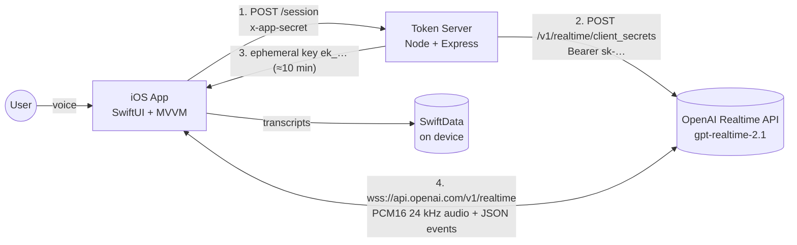
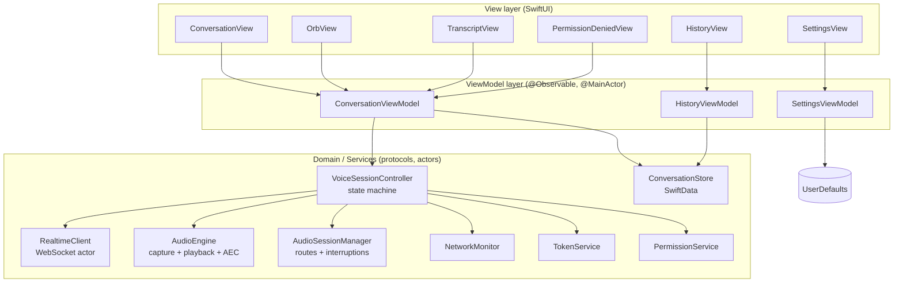
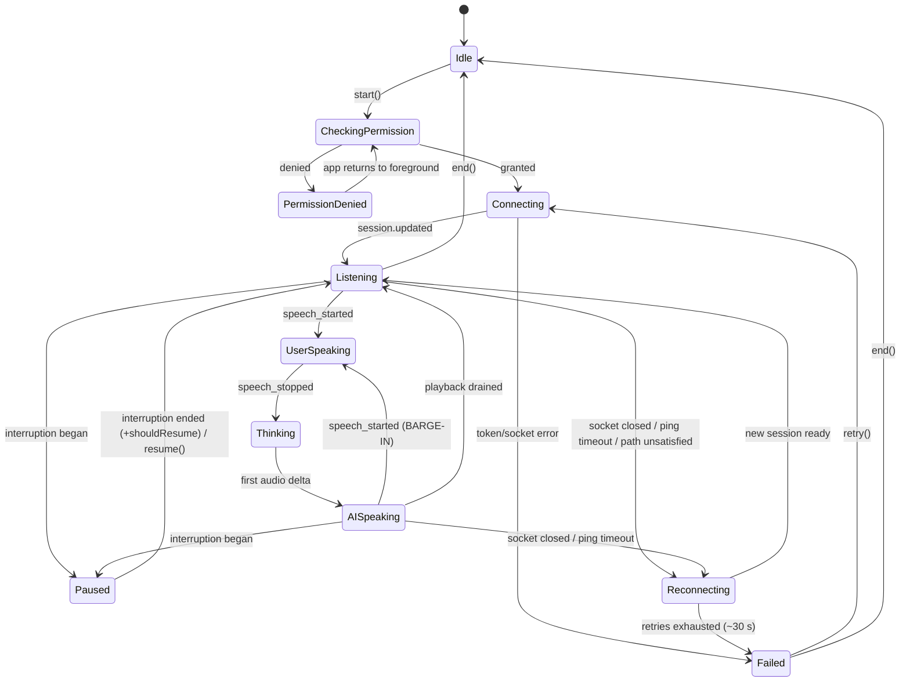
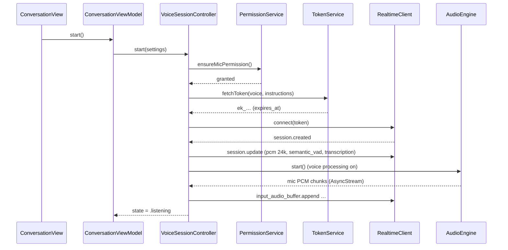
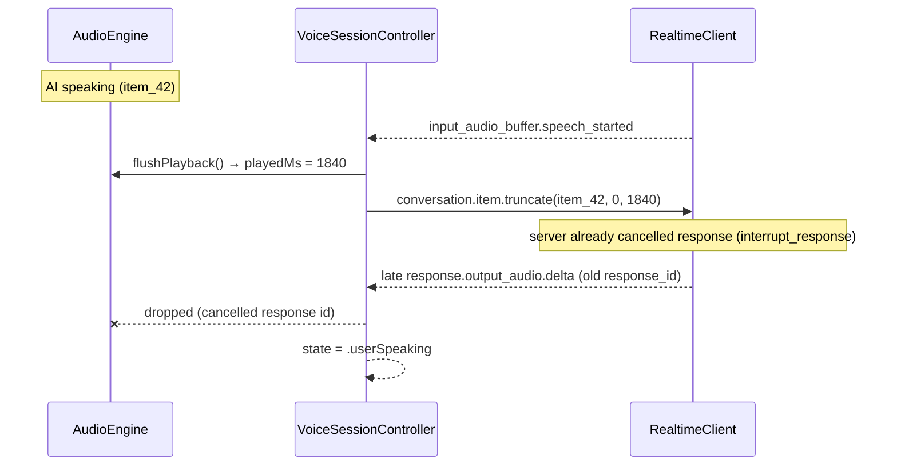

# HLD — V2V Speech-to-Speech App

Related: [PRD](PRD.md) · [LLD](LLD.md) · [Decisions](DECISIONS.md)

## 1. System context



- The **OpenAI API key lives only on the token server** (env var). The app gets a short-lived client secret per session. (PRD E8)
- After the handshake, audio goes **directly app ↔ OpenAI** over WebSocket. The token server isn't in the audio path, so it adds no latency.

## 2. Architecture (MVVM)



**Rules**
- Views only render ViewModel state and send intents (`start()`, `end()`, `toggleMute()`).
- ViewModels are `@MainActor @Observable`. They map domain state to UI state; no audio or network code.
- `VoiceSessionController` owns the **session state machine** and coordinates the services. All edge-case logic lives here, so it's unit-testable with fakes.
- Every service sits behind a protocol, so tests inject fakes.
- Swift Concurrency throughout: `actor`s, `AsyncStream`, and `NotificationCenter.notifications(named:)`. No Combine.

## 3. Session state machine



(Any active state → `Idle` on `end()`. Any active state → `Paused`/`Reconnecting` on the matching events. Only the main edges are drawn.)

## 4. How each edge case is handled

| # | Edge case | Mechanism |
|---|---|---|
| E1 | **Barge-in** | Server `semantic_vad` with `interrupt_response: true` auto-cancels the response. On `input_audio_buffer.speech_started` the app **immediately flushes the local player** (`AVAudioPlayerNode.stop()`), computes the ms actually played, and sends `conversation.item.truncate(item_id, audio_end_ms)` so the model's memory matches what the user heard. Late `output_audio.delta`s for the cancelled response are dropped by `response_id` |
| E2 | **Echo** | Apple **voice processing I/O** (`setVoiceProcessingEnabled(true)` on the engine's input node). The hardware AEC uses the engine's own output as the reference, so the mic signal sent to OpenAI has the AI voice removed. Audio session `mode = .voiceChat`. Server `noise_reduction` adds a second layer. Capture and playback **must share one `AVAudioEngine`** so AEC has the reference |
| E3 | **Mic denied** | `AVAudioApplication.requestRecordPermission()` before connecting. `.denied` → `PermissionDenied` state → explanation view + `UIApplication.openSettingsURLString`. Re-check on `scenePhase == .active` |
| E4 | **AirPods / route change** | Observe `AVAudioSession.routeChangeNotification` and `AVAudioEngineConfigurationChange`. On `.oldDeviceUnavailable` (AirPods removed): pause playback ~300 ms, rebuild/restart the engine on the new route, continue. On `.newDeviceAvailable`: restart the engine on the new route. The session (socket) is never torn down for a route change |
| E5 | **Calls / Siri / alarms** | `AVAudioSession.interruptionNotification`. `.began` → stop capture + flush playback, `Paused`, socket kept alive. `.ended` + `.shouldResume` → reactivate session, restart engine, `Listening`; otherwise show "Tap to resume". If the socket died during the pause → `Reconnecting` |
| E6 | **Background** | `UIBackgroundModes: audio`. The active `.playAndRecord` session keeps the app alive while the mic is live. Media-services reset (`mediaServicesWereResetNotification`) → full audio rebuild |
| E7 | **Network drop** | Three detectors: (a) WebSocket receive error/close, (b) app-level ping every 10 s with a 5 s timeout, (c) `NWPathMonitor` unsatisfied. → `Reconnecting`: exponential backoff 0.5, 1, 2, 4, 8, 8 s (~30 s cap), **fresh token each attempt**, new session seeded with the last ~10 transcript turns as `conversation.item.create`. Every await has a timeout, so nothing can hang. Exhausted → `Failed` + Retry |
| E8 | **No key in app** | The app has only `TOKEN_SERVER_URL` + `APP_SHARED_SECRET` (xcconfig, not committed). The server calls `/v1/realtime/client_secrets` with the session config (model, voice, instructions, VAD) and returns `{ value, expires_at }` |
| E9 | **Server abuse** | `x-app-secret` header check (constant-time compare) + `express-rate-limit` (e.g. 10 req/min/IP) + CORS off + session config built on the server (the client only sends a `personaId`; prompts and voices live on the server, [D-020](DECISIONS.md)) |

## 5. Key flows

### 5.1 Start session


### 5.2 Barge-in


## 6. Deployment
| Piece | Dev | Device testing / demo |
|---|---|---|
| Token server | `npm run dev` on Mac; Simulator uses `http://localhost:8787` | Same Mac server; the iPhone on the **same Wi-Fi** uses `http://<mac-lan-ip>:8787` (ATS local-networking exception). **No cloud hosting** ([D-019](DECISIONS.md)) |
| iOS app | Simulator (no AEC/AirPods realism) | **Physical iPhone required** for E2, E4, E5, E6 |

## 7. Repo layout
```
V2Vfolder/
├── V2Vfolder/              # iOS app (MVVM)
│   ├── App/  Views/  ViewModels/  Domain/  Services/  Models/  Config/
├── V2VfolderTests/         # Swift Testing unit tests
├── V2VfolderUITests/       # XCUIAutomation UI tests
├── token-server/           # Node + Express
└── docs/                   # PRD, HLD, LLD, TEST_CASES, DECISIONS
```
